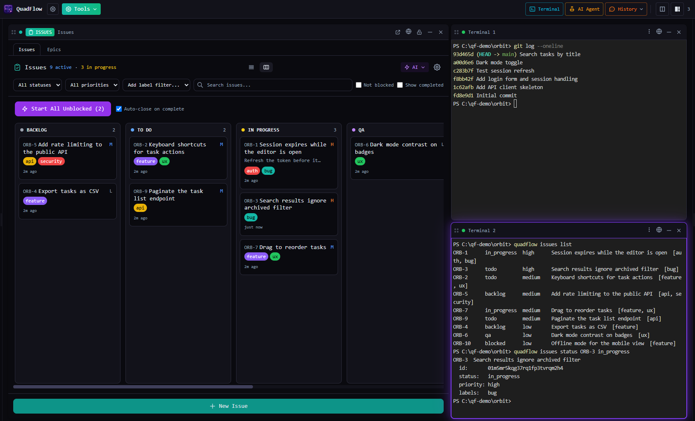
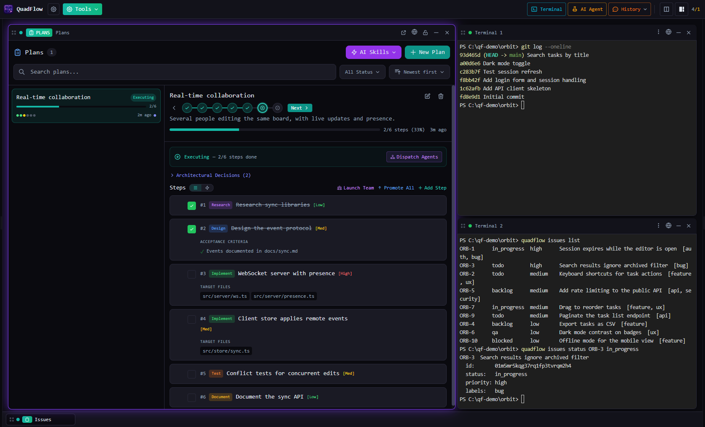
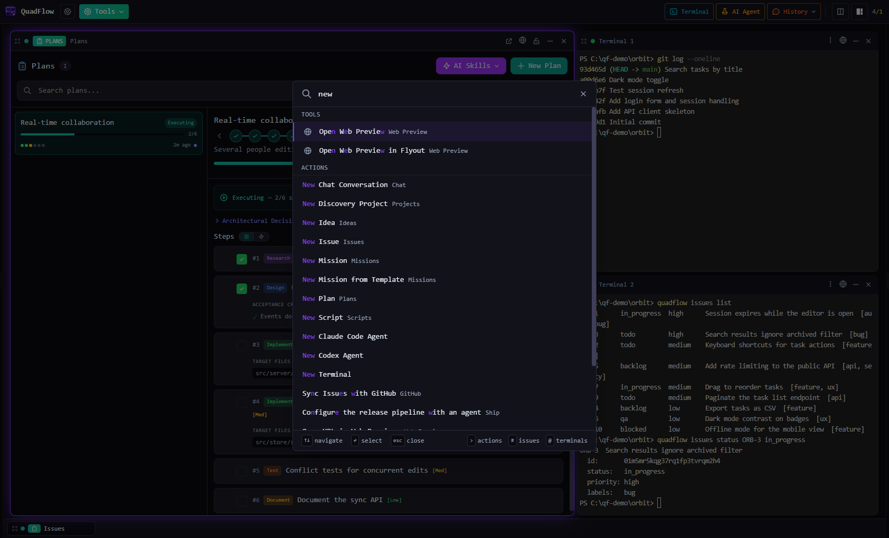
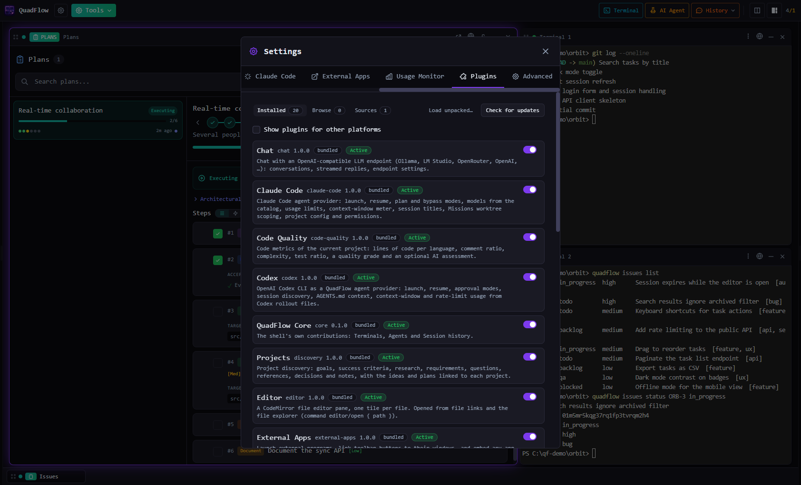
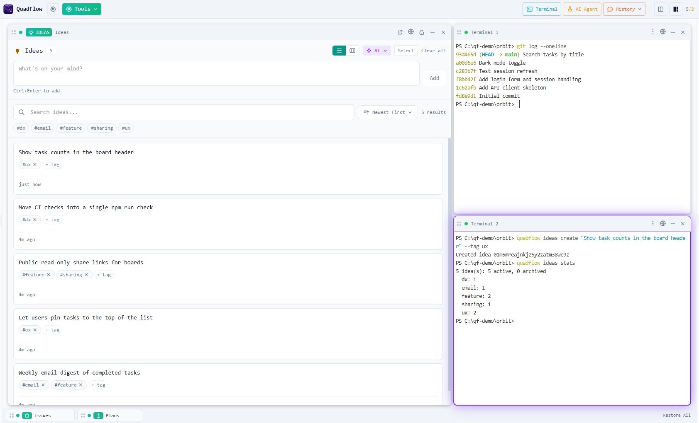

# QuadFlow

**Run AI coding agents side by side, with the project tools they need.**

[](LICENSE)


QuadFlow is a desktop app for working with several AI coding agents at once. It puts Claude Code,
Codex and any other terminal agent in a tiled layout of real terminals, next to project tools:
ideas, issues, plans, scripts, releases, chat and multi-agent missions. A built-in `quadflow` CLI
lets the agents read and update those same tools, so you and your agents work from one board.

The app is a small core; every tool and every agent integration is a plugin.



## Features

**Workspace**

- **Tiled terminals.** Split, resize, drag and rearrange tiles in a mosaic layout, or apply a preset
  (grid, columns, rows, main + sidebar, focus). Every terminal tile is a real PTY.
- **Agents side by side.** Launch an agent per tile from the toolbar or the command palette, pick
  a model, and resume past sessions from the History flyout.
- **Projects and workspaces.** A project is a working directory; a workspace is a saved layout of
  terminals and tools inside it. Global workspaces carry tiles across projects.
- **Command palette.** `Ctrl+K` (`Cmd+K` on macOS) for tools, actions and projects; `#` searches
  issues, `@` jumps to terminals, `>` lists actions.

**Project tools**

- **Ideas, Issues, Plans, Projects.** Capture ideas, track work on a kanban board with epics, labels,
  acceptance criteria and dependencies, turn a spec into plan steps and promote them to issues.
- **Scripts and Ship.** Saved build/test/run commands with live output, and a configurable release
  pipeline.
- **Missions.** Teams of agents working a shared set of issues, with messages and a merge queue.
- **Developer tools.** Git and GitHub, a file editor, web preview, any TUI program in a tile, code
  metrics, and chat with an OpenAI-compatible endpoint.

**Built for agents**

- **One data layer for everyone.** The GUI, the `quadflow` CLI and plugins all read and write the
  same data. When an agent runs `quadflow issues close ORB-3`, the board updates live.
- **Agent context.** QuadFlow keeps a managed region in `CLAUDE.md` / `AGENTS.md` that tells agents
  which `quadflow` commands the project uses.
- **Local-first.** Project data lives in a `.quadflow/` folder in your project (shareable through
  git); app state stays on your machine. No account required.

**Extensible**

- **Plugins for everything.** Plugins contribute tiles, toolbar items, commands, settings pages, CLI
  subcommands, agent providers and optional sidecar processes, behind declared permissions.
  First-party plugins run in the app; third-party plugins run sandboxed.

## Screenshots

| | |
|---|---|
|  |  |
| **Plans** — a spec broken into steps, ready to promote to issues | **Command palette** — actions from every plugin in one place |
|  |  |
| **Settings → Plugins** — enable, install and update plugins | **Light theme** — an idea created from the CLI shows up live |

## Install

Download the installer for your platform from the
[latest release](https://github.com/HardHeadHackerHead/QuadFlow/releases/latest):

| Platform | Download |
|---|---|
| Windows 10/11 (x64) | `QuadFlow_<version>_x64-setup.exe` |
| macOS (Apple Silicon) | `QuadFlow_<version>_aarch64.dmg` |
| macOS (Intel) | `QuadFlow_<version>_x64.dmg` |
| Linux (x64) | `QuadFlow_<version>_amd64.AppImage` or `.deb` |

QuadFlow updates itself from the same releases. To run agents, install the agent CLIs you want
(for example Claude Code or Codex) so they are on your `PATH`; QuadFlow detects them.

Some plugins are platform-specific (External Apps and OBS Tracker are Windows-only); they only
appear on the platforms they support.

### Upgrading from QuadFlow 1.x

Run the new installer over the old one: it upgrades the existing install in place (same folder,
same Start-menu entry, the `quadflow` CLI keeps working). When the old uninstaller asks, leave
**"Delete the application data"** unticked — the new version reads the 1.x project list from it.

On first start QuadFlow offers **Bring over your projects from QuadFlow 1.x** (later: Settings →
Advanced → *Import from QuadFlow 1.x…*, or `quadflow import-v1 --all`; add `--dry-run` to preview).
It adds your 1.x projects to the projects list. Settings and layouts start at the defaults.

This version can't read the issues, plans and ideas a project kept in QuadFlow 1.x. When such a
project is imported or opened, its `.quadflow/` folder is moved to `.quadflow-v1-backup/` in the
project folder (nothing is deleted) and a fresh `.quadflow/` is created.

### Build from source

You need Rust (stable), Node.js 20+ and the [Tauri v2 prerequisites](https://v2.tauri.app/start/prerequisites/)
for your platform. [CONTRIBUTING.md](CONTRIBUTING.md#development-setup) lists them per OS.

```bash
git clone https://github.com/HardHeadHackerHead/QuadFlow.git quadflow
cd quadflow
npm ci
npm run tauri dev     # run the app in development mode
npm run build         # release app + installer for this platform (target/release/bundle/)
```

## Quick start

1. **Open a project.** On first launch the welcome guide walks you through agents, a project folder,
   the CLI and plugins. Later, use **Open another folder…** or the palette (**Project & Workspaces**).
2. **Open terminals and tools.** **Terminal** in the toolbar opens a shell tile; **Tools** opens
   Issues, Plans, Ideas, Scripts and the rest, in a tile or as a flyout. Drag tiles to arrange them.
3. **Launch agents.** **AI Agent** in the toolbar (or **New Claude Code Agent** / **New Codex
   Agent** in the palette) starts an agent in a new tile. **History** resumes earlier sessions.
4. **Let agents use the CLI.** Install `quadflow` on your `PATH` from the welcome guide or the CLI
   status button in the toolbar, then choose which tool docs go into the project's agent context
   files. From then on an agent can do this:

```bash
quadflow issues list --status todo --json          # find work
quadflow issues claim ORB-3 --agent-label "agent-1" # take it
quadflow issues close ORB-3                         # done; unblocks dependent issues
```

## Plugins

### Bundled

Shipped with the app and enabled by default.

| Plugin | What it does |
|---|---|
| [Claude Code](plugins/claude-code/README.md) | Agent provider: launch, resume, plan and bypass modes, models, usage limits, context-window meter |
| [Codex](plugins/codex/README.md) | Agent provider for the OpenAI Codex CLI: launch, resume, approval modes, `AGENTS.md` context |
| [Usage Monitor](plugins/usage-monitor/README.md) | Rate-limit windows of every agent provider, as a tile and a toolbar widget |
| [Ideas](plugins/ideas/README.md) | Capture, tag and triage ideas; merge them, promote them to issues |
| [Issues](plugins/issues/README.md) | List and kanban views, epics, labels, acceptance criteria, dependencies, work an issue with an agent |
| [Plans](plugins/plans/README.md) | Spec drafting and review, steps, promotion to issues, agent coordination view |
| [Projects](plugins/discovery/README.md) | Discovery: goals, research, requirements, questions and decisions, linked to ideas and plans |
| [Scripts](plugins/scripts/README.md) | `package.json`, Python and saved scripts with live output, script groups, terminal environments, agent auto-fix |
| [Ship](plugins/ship/README.md) | The project's release pipeline: readiness checks, dry runs, live output, run history |
| [Missions](plugins/missions/README.md) | Teams of agents working a shared set of issues: proposals, merge queue, messages |
| [Chat](plugins/chat/README.md) | Chat with an OpenAI-compatible endpoint (Ollama, LM Studio, OpenRouter, OpenAI, …) |
| [GitHub](plugins/github/README.md) | Local git (status, commit, push, checkpoints) and GitHub (PRs, releases, issue sync) |
| [Editor](plugins/editor/README.md) | A CodeMirror file editor, one tile per file |
| [Web Preview](plugins/web-preview/README.md) | Preview your dev server in a tile: address bar, zoom, mobile view, screenshots |
| [TUI Tool](plugins/tui/README.md) | Run any terminal program (lazygit, htop, a REPL…) in a tile |
| [Code Quality](plugins/code-quality/README.md) | Lines of code per language, complexity, test ratio, a quality grade |
| [External Apps](plugins/external-apps/README.md) | Windows: launch programs, link toolbar buttons to their windows, embed a window in a tile |

The terminals, the AI Agent toolbar item and the session History are themselves the built-in
[QuadFlow Core](plugins/core/README.md) plugin.

### Optional

Not part of the installer. Install them from **Settings → Plugins → Browse**, or with
`quadflow plugins install <id>`.

| Plugin | What it does |
|---|---|
| [Semantic Search](plugins/semantic-search/README.md) | Search past agent sessions by meaning, with local embeddings |
| [Local Titles](plugins/local-titles/README.md) | Offline terminal titles from a local model (llama.cpp) |
| [YouTube Live](plugins/youtube-live/README.md) | Streamer kit: live chat overlay, `!idea` capture, polls, points and a slot machine |
| [YouTube Shorts](plugins/youtube-shorts/README.md) | Streamer kit: a YouTube Shorts player in a tile |
| [OBS Tracker](plugins/obs-tracker/README.md) | Streamer kit, Windows: an OBS webcam source that follows a tile |
| [Discord Bot](plugins/discord-bot/README.md) | Mirror terminals into Discord threads (experimental, on hold) |

### Plugin sources

A plugin source is a repository that publishes an `index.json`. The official source is the
[`plugins/`](plugins/) folder of this repository. Add others in Settings → Plugins → Sources, or:

```bash
quadflow plugins sources add github:OWNER/REPO
quadflow plugins browse
quadflow plugins install acme.my-plugin
```

Installs and updates are checked against the archive's sha256, and a plugin asks for consent
before it gets new permissions.

### Writing plugins

Scaffold a plugin, build it in watch mode, and load it with **Settings → Plugins → Load
unpacked…**; edits hot-reload:

```bash
npm create quadflow-plugin -- ../my-plugin --template tile --id acme.my-plugin
cd ../my-plugin && npm run dev
```

Start with the [plugin author docs](docs/plugins/README.md). [`plugins/hello`](plugins/hello/) and
[`plugins/hello-sandboxed`](plugins/hello-sandboxed/) are example plugins that exercise every
host-API group (dev builds only).

## CLI

The app binary doubles as the CLI: no arguments start the GUI, any arguments run a command. Every
command supports `--json` and exits non-zero on failure. The CLI finds the project by walking up
from the current directory to `.quadflow/config.json` (or takes `--project <path>`).

| Command | What it does |
|---|---|
| `quadflow init --name Orbit --code ORB` | Make the current directory a project (issue refs `ORB-1`, `ORB-2`, …) |
| `quadflow issues list --status todo,in_progress` | List issues, filtered by status, priority, label or text |
| `quadflow issues create "Fix login" --priority high --labels bug` | Create an issue |
| `quadflow issues status ORB-3 in_progress` | Move an issue on the board |
| `quadflow ideas create "Weekly digest" --tag feature` | Capture an idea |
| `quadflow plans promote <plan-id>` | Promote a plan's steps to issues (idempotent) |
| `quadflow scripts list` | List the project's saved scripts |
| `quadflow missions claim-next <mission-id> <member>` | Claim the next free issue for a mission member |
| `quadflow docs --list` / `quadflow docs issues` | Print the agent docs for a command group |
| `quadflow context enable issues` | Put a module's docs into the project's agent context files |
| `quadflow plugins list` | List plugins and their status |

Plugins can add their own subcommands. `quadflow --help` and `quadflow <command> --help` show the
full surface.

## How it works

```
quadflow (one binary: no args -> GUI, args -> CLI)
├── quadflow-core      Rust library: the only place data, schemas and logic live
│   ├── store/         per-project .quadflow/ files + the app SQLite database
│   ├── domains/       ideas, issues, plans, discovery, scripts, ship, chat, missions, app
│   ├── plugins/       manifests, registry, permissions, host API, sidecars, sources
│   ├── agents/        agent-provider framework: detect, launch, models, sessions
│   └── cli/           the clap command tree (plugins can add subcommands)
├── src-tauri          Tauri v2 shell: windows, PTYs, native integrations, thin commands
└── src                React shell: mosaic layout, terminals, plugin host, settings
plugins/               first-party plugins + index.json (the official plugin source)
packages/              @quadflow/plugin-api, @quadflow/ui, plugin build tools, sidecar SDKs
```

- **One data layer.** `quadflow-core` owns every schema and all logic. The GUI (through Tauri
  commands), the CLI and plugins (through the host API) all call it, and changes from any process
  arrive everywhere as change events.
- **Storage.** Project content is one JSON file per entity in `<project>/.quadflow/`; app state
  (workspaces, layouts, settings, plugin state) is in one local SQLite database.
- **Plugins.** A `quadflow-plugin.json` manifest declares a plugin's contributions, permissions and
  sidecar. One Rust dispatch table enforces permissions for UI, sidecars and CLI alike.
- **Agent providers.** Claude Code and Codex are declarative provider specs in plugins; the core
  contains no agent-specific code.

Details: [docs/architecture/](docs/architecture/README.md) and the
[roadmap](docs/ROADMAP.md).

## Documentation

| Doc | For |
|---|---|
| [Contributing guide](CONTRIBUTING.md) | Dev setup, builds, checks, project structure, pull requests |
| [Writing plugins](docs/plugins/README.md) | Plugin authors: getting started, manifest, host API, permissions, sidecars, publishing |
| [Architecture](docs/architecture/README.md) | The data layer, the plugin system and agent providers |
| [Releasing](docs/RELEASING.md) | Maintainers: local release builds with `quadflow ship` |
| [Security policy](SECURITY.md) | Reporting vulnerabilities |
| [Code of conduct](CODE_OF_CONDUCT.md) | Community standards |

## Contributing

Contributions are welcome. Read [CONTRIBUTING.md](CONTRIBUTING.md) first: there is no hosted CI,
so `npm run check` runs every check locally. Contributors sign the [Contributor License
Agreement](CLA.md) once, by adding one line to the description of their first pull request.

## License

QuadFlow is free software under the [GNU Affero General Public License v3.0 only](LICENSE)
(`AGPL-3.0-only`). Contributions are accepted under the [QuadFlow CLA](CLA.md): you keep the
copyright to your work and grant the project a license to distribute it, including under
additional licenses.
