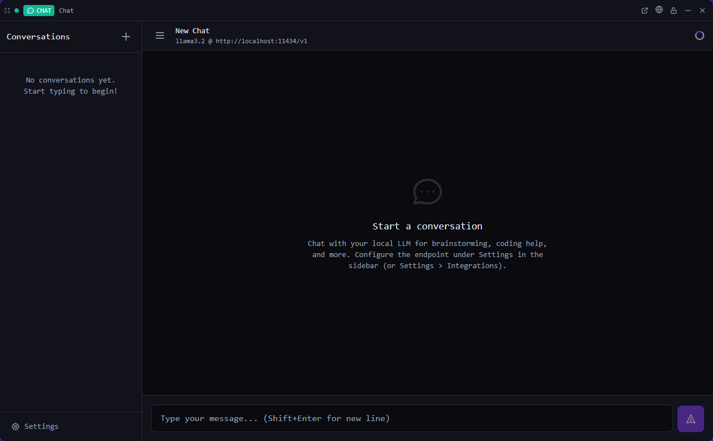

# Chat

Chat with any OpenAI-compatible model — local (Ollama, LM Studio) or hosted (OpenRouter, OpenAI, …) — next to your terminals.

*Bundled with QuadFlow.*

Chat is a plain conversation tool, separate from the coding agents: point it at an
OpenAI-compatible endpoint, pick a model and ask. Replies stream in, conversations are kept, and
the same conversations are available to scripts and agents through `quadflow chat`.



## Features

- Conversations with **streamed replies**; fenced code blocks are rendered with a copy button.
- Rename and delete conversations; find them from the command palette.
- **Endpoint settings** in the tile: endpoint URL, optional API key, model (listed from the
  endpoint), temperature, max tokens, timeout and a default system prompt.
- The API key is stored in the OS keychain; the settings only show whether one is stored.
- **Ask from anywhere**: the *Ask the Chat Model…* command starts a conversation with your
  question and opens the answer.

## Usage

Open **Chat** from the Tools menu (or pin it to the toolbar), in a pane or a flyout. No project is
required. Open the settings in the tile first: the default endpoint is
`http://localhost:11434/v1` (Ollama) with model `llama3.2`.

| Command | Where | What it does |
|---|---|---|
| New Chat Conversation | Palette | Creates a conversation and opens it |
| Ask the Chat Model… | Palette | Prompts for a question, starts a conversation and sends it |
| Open Chat | Used by toasts and links | Opens the Chat tile |

The palette provider *Chat conversations* finds conversations by title.

## CLI

`quadflow docs chat` prints the agent doc ([docs/agent.md](docs/agent.md)).

| Command | Purpose |
|---|---|
| `quadflow chat list [--this-project]` | Conversations, most recent first |
| `quadflow chat create [--title …] [--model …] [--system-prompt …] [--this-project]` | New conversation |
| `quadflow chat send <id> "<text>"` | Send a message; the answer streams to stdout |
| `quadflow chat messages <id>` (alias `history`) · `get` · `rename` · `delete` | Conversations |
| `quadflow chat settings [--endpoint <url>] [--model <m>] [--temperature 0.7] …` | Show or change settings |
| `quadflow chat key set --from-env <VAR>\|--stdin` · `key clear` · `key status` | API key |
| `quadflow chat models` | Models offered by the endpoint |
| `quadflow chat discover [--port 11434]` · `check <url>` | Find LLM servers on the local network |

## Settings

Stored in the app settings namespace `chat`, edited in the tile or with `quadflow chat settings`.

| Setting | Default | Description |
|---|---|---|
| Endpoint | `http://localhost:11434/v1` | OpenAI-compatible base URL |
| Model | `llama3.2` | Default model for new conversations |
| Temperature | `0.7` | Sampling temperature |
| Max tokens | `2048` | Maximum tokens per reply |
| Timeout | `60` s | Request timeout |
| System prompt | none | Default system prompt for new conversations |
| API key | none | Optional; kept in the OS keychain |

## Permissions

| Permission | Why |
|---|---|
| `data:chat:write` | Conversations, messages and settings (the core makes the HTTP requests) |
| `secrets` | Store the endpoint API key in the OS keychain |
| `clipboard:write` | Copy code blocks |

## Data

Conversations and messages live in the app database, not in the project; a conversation can be
tied to a project (`--this-project`). Settings use the `chat` namespace; the API key is a keychain entry of this plugin.

## Development

```bash
cd plugins/chat
npm run build        # quadflow-plugin build → dist/
```

```
src/index.tsx    definePlugin: tile, commands, palette provider
src/model.ts     conversations, streaming, settings state over ctx.data.chat
src/api.ts       API key handling via ctx.secrets
src/ChatTile.tsx conversation list, messages, settings modal
```

Built on the public host API only (`ctx.data.chat.*`, `ctx.secrets`). Authoring docs:
[docs/plugins/](../../docs/plugins/README.md).

## License

AGPL-3.0-only, part of QuadFlow.
