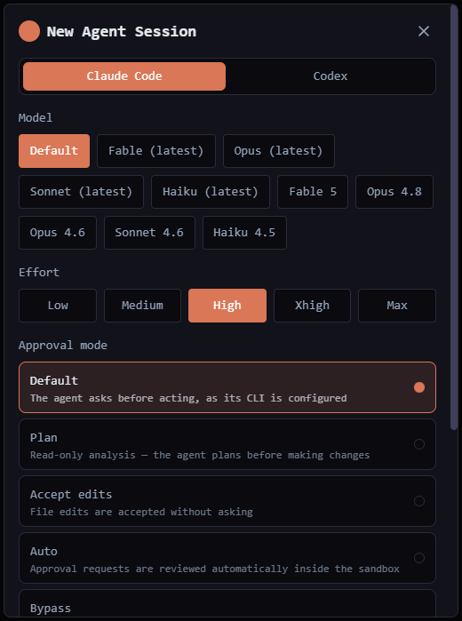

# Claude Code

Run Anthropic's [Claude Code](https://docs.anthropic.com/en/docs/claude-code) CLI as a QuadFlow agent.

*Bundled with QuadFlow.*

This plugin is an **agent provider**: it tells QuadFlow how to find, launch, resume and observe
the `claude` CLI, and adds a project config tile, a permissions page and a rewind view. Most of it
is declarative (`contributes.agentProvider` in the manifest, interpreted by the core); the module
in `src/` only implements the parts that need code.



## Requirements

- Claude Code installed and on `PATH` (or in one of its standard install locations):
  `npm install -g @anthropic-ai/claude-code`
- Logged in once in a terminal (`claude`), so it can run without an interactive sign-in.

QuadFlow detects the CLI with `claude --version` and checks `~/.claude/local/`, `~/.local/bin/`
and the npm/Homebrew global bin directories.

## Features

- **Launch and resume** from the AI Agent dialog, with model, reasoning effort and approval mode.
- **Session tracking**: QuadFlow assigns the session id up front (`--session-id`), so every
  terminal maps to its transcript and can be resumed later (`--resume`).
- **Context meter**: context-window usage of the running session, estimated from the transcript.
- **Usage limits**: account rate-limit windows, shown by the [Usage Monitor](../usage-monitor/README.md).
- **Session titles** from Claude Code's own session titles.
- **Attention detection**: QuadFlow flags the terminal when Claude waits for input.
- **Project scaffold**: on project open, the bundled `.claude/` template (about 50 QuadFlow skills
  such as `/issue-to-prompt` and `/setup-ship`, plus a default allow-list) is copied into the project.
  Existing files are never overwritten; `settings.local.json` is merged.
- **Missions scoping**: for a Missions agent, writes a `PreToolUse` hook into its worktree that
  blocks writes outside the agent's assigned files (and all writes by a coordinator).

## What the provider spec declares

| Field | Value |
|---|---|
| Launch | `claude` with `--model {model}`, `--effort {effort}` (`low` … `max`, default `high`) |
| Approval modes | default · plan (`--permission-mode plan`) · accept-edits · auto · bypass (`--dangerously-skip-permissions`) |
| Resume | `--resume {sessionId}`; new sessions get `--session-id {sessionId}` |
| One-shot | `claude -p`, prompt on stdin |
| Models | catalog key `claude-code` in `catalog/models.json` |
| Sessions | `~/.claude/projects/<cwd, non-alphanumerics as ->/*.jsonl` |
| Context file | `CLAUDE.md` (QuadFlow writes enabled context modules into its managed region) |
| Hooks | `usage`, `contextUsage`, `sessionTitle`, `prepareWorktree` |

The `usage` hook runs `claude` in a hidden terminal, types `/usage`, reads the rate-limit bars and
exits; no prompt is sent.

## Usage

| Contribution | How to open | What it does |
|---|---|---|
| Tile **Claude Config** | Tools menu, pane or flyout (needs a project) | Tabs: instructions (`CLAUDE.md`), env (`.claude/settings.local.json` env vars), skills, sessions with rewind points, permissions |
| Settings page **Claude Code** | Settings → Claude Code | Toggle allow/deny rules in the project's `.claude/settings.local.json` from a catalog (QuadFlow CLI, git, build tools, …) |
| Command **Claude: Show rewind points** | Palette, when the active terminal runs Claude Code | Lists one point per prompt with the edits that followed; *Rewind here* drives Claude's `/rewind` in that terminal |

## Permissions

| Permission | Why |
|---|---|
| `agents:read` | Read the model catalog for the context-window size |
| `fs:read:home` | Read session transcripts under `~/.claude/projects/` |
| `fs:write:project` | Edit `CLAUDE.md` and `.claude/` in the project and in mission worktrees |
| `terminal:spawn` | Run `claude /usage` in a hidden terminal |
| `terminal:io` | Drive `/rewind` in a running Claude terminal |

## Data

Nothing of its own: it reads Claude Code's transcripts in `~/.claude/projects/` and edits the
project's `CLAUDE.md` and `.claude/` files. The scaffold is skipped when the app setting
`scaffold.claude-code` in the `agents` namespace is `false`.

## Development

```bash
cd plugins/claude-code
npm run build        # quadflow-plugin build → dist/
```

```
src/index.tsx          definePlugin: tile, settings page, command, provider hooks
src/hooks.ts           contextUsage, sessionTitle, prepareWorktree (scope hook source)
src/usage.ts           `/usage` scraping
src/session.ts         pure JSONL parsing: context estimate, rewind points, titles
src/ConfigTile.tsx     Claude Config tile; PermissionsPage.tsx, RewindView.tsx
assets/claude-template the `.claude/` scaffold (skills + settings.local.json)
```

To write a provider for another agent CLI, read
[docs/plugins/agent-providers.md](../../docs/plugins/agent-providers.md); [Codex](../codex/README.md)
is the smaller example (hooks only, no UI).

## License

AGPL-3.0-only, part of QuadFlow.
