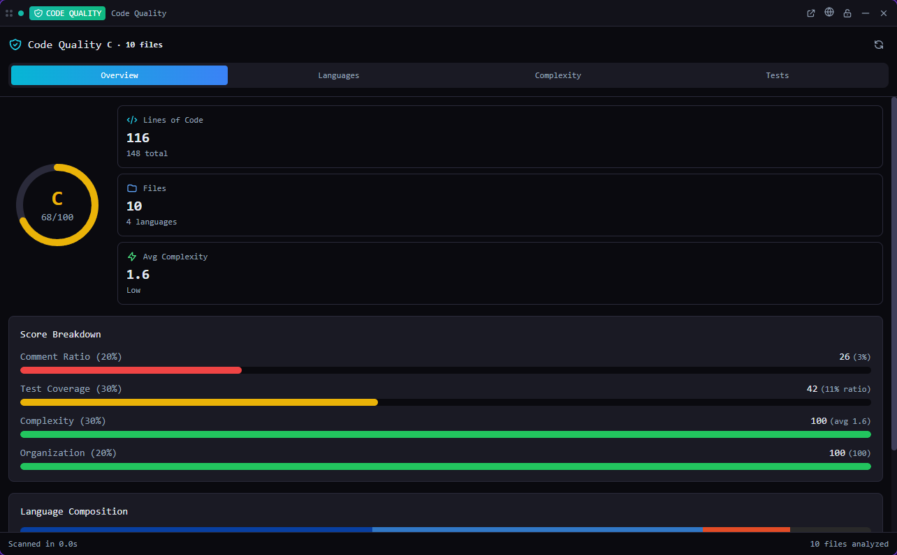

# Code Quality

**Code metrics of the current project at a glance.**

*Bundled with QuadFlow.*

Scan the open project for lines of code per language, comment ratio, complexity and test ratio,
and get an overall quality grade. An optional AI insight sums up the scan in a few sentences.



## Features

- Lines of code, comments and blank lines per language, with file counts.
- Complexity per file and a distribution: low (1–5), moderate (6–10), high (11–20), very high (21+).
- Test-to-source file ratio, overall and per language.
- An overall score from 0 to 100 and a grade (A ≥ 85, B ≥ 70, C ≥ 55, D ≥ 40, F below), weighted
  from comment ratio (20%), test coverage (30%), complexity (30%) and organization (20%).
- Respects the project's `.gitignore` and skips common dependency and build folders
  (`node_modules` and others) and hidden directories.
- **AI insight**: a short assessment of the last scan from the chat endpoint configured in
  QuadFlow. Errors (for example no endpoint configured) are shown in the tile.

## Usage

Open the **Code Quality** tool from the toolbar, as a pane or a flyout (needs an open project). The
pane and the flyout share one scan.

| Command | What it does |
|---|---|
| Rescan Code Quality | Opens the tile and scans the project again |
| Code Quality AI Insight | Scans if needed, then asks for the AI assessment |

## Permissions

| Permission | Why |
|---|---|
| `fs:read:project` | Read the project's files and `.gitignore` |
| `data:chat:write` | Ask the chat endpoint for the AI insight |

## Data

Nothing is stored: scan results and the insight live in memory until you rescan or restart.

## Development

```bash
cd plugins/code-quality
npm run build      # quadflow-plugin build --no-sidecar → dist/
npm run dev        # rebuild on change
```

- `src/index.tsx` — plugin entry: the `report` tile and the commands
- `src/analysis.ts` — file walk, `.gitignore` matching, line counts, complexity, scoring
- `src/model.ts` — per-context store shared by the pane and flyout; AI insight
- `src/CodeQualityTile.tsx`, `src/types.ts` — the report view and metric types

The GUI e2e test is `scripts/ui/code-quality.test.mjs`. Plugin authoring docs:
[docs/plugins/](../../docs/plugins/README.md).

## License

AGPL-3.0-only, part of QuadFlow.
