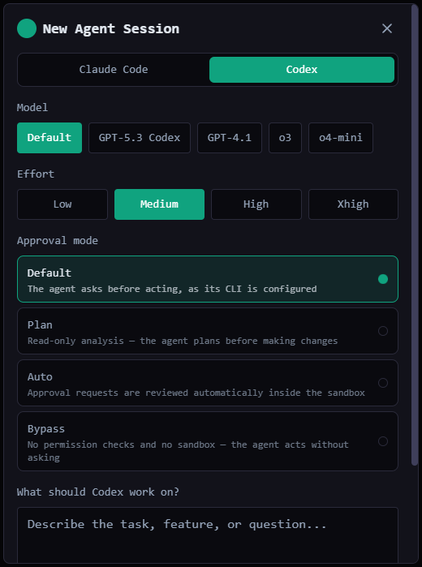

# Codex

Run OpenAI's [Codex CLI](https://developers.openai.com/codex/cli) as a QuadFlow agent.

*Bundled with QuadFlow.*

This plugin is an **agent provider** and the smallest complete example of one: launch, resume,
approval modes, session discovery and the `AGENTS.md` context file are declared in the manifest
and interpreted by the core; `src/` only implements three hooks. It has no tiles or settings.



## Requirements

- Codex installed and on `PATH` (or in a standard install location):
  `npm install -g @openai/codex`
- Logged in once in a terminal (`codex`), so it can start without an interactive sign-in.

QuadFlow detects the CLI with `codex --version` and also checks
`%LOCALAPPDATA%/Programs/OpenAI/Codex/bin/`, the npm global bin, `/opt/homebrew/bin`,
`/usr/local/bin` and `~/.local/bin`.

## Features

- **Launch and resume** from the AI Agent dialog, with model, reasoning effort and approval mode.
- **Session discovery**: after launch QuadFlow finds the new rollout file in `~/.codex/sessions/`
  and links it to the terminal, so the session can be resumed later.
- **Context meter**: context-window usage of a session, from the rollout's `token_count` events
  (resets after a `compacted` entry).
- **Usage limits**: account rate-limit windows from the newest rollouts, shown by the
  [Usage Monitor](../usage-monitor/README.md): the 5-hour and weekly windows of the main `codex`
  limit, plus the windows of any other limit the rollouts report data for. Reading them runs no
  command.
- **Missions context**: writes each Missions agent's file scope and mission context into the
  worktree's `AGENTS.md`. This is advisory — Codex has no hook mechanism to enforce it.

## What the provider spec declares

| Field | Value |
|---|---|
| Launch | `codex` with `--model {model}`, `-c model_reasoning_effort={effort}` (`low` … `xhigh`, default `medium`) |
| Approval modes | default · plan (`--sandbox read-only --ask-for-approval on-request`) · auto (`--approve-for-me`) · bypass (`--dangerously-bypass-approvals-and-sandbox`) |
| Resume | `codex resume {sessionId}` (prefix position) |
| One-shot | `codex exec --ephemeral --skip-git-repo-check --color never -`, prompt on stdin |
| Models | catalog key `codex` in `catalog/models.json` |
| Sessions | `discover` strategy: `~/.codex/sessions/**/rollout-*.jsonl`, id and cwd from the `session_meta` line |
| Context file | `AGENTS.md` (QuadFlow writes enabled context modules into its managed region) |
| Hooks | `usage`, `contextUsage`, `prepareWorktree` |

## Usage

Pick **Codex** as the provider in the AI Agent dialog. Once detected, it can also be chosen when
working on an issue from the Issues tool and for Missions members, and it is used by tools that
launch the default provider (such as Scripts auto-fix) when it is your default. The QuadFlow
skill buttons in the project tools prefer Claude Code, because those skills are Claude Code
slash commands.

## Permissions

| Permission | Why |
|---|---|
| `agents:read` | Provider and model information (low risk; the hooks receive what they need as arguments) |
| `fs:read:home` | Read rollout files under `~/.codex/sessions/` |
| `fs:write:project` | Write the managed region of `AGENTS.md` in mission worktrees |

## Data

Nothing of its own: it reads Codex's rollout files and edits `AGENTS.md` in worktrees.

## Development

```bash
cd plugins/codex
npm run build        # quadflow-plugin build → dist/
npm test             # node --test: rollout parsing and worktree regions
```

```
src/index.ts      definePlugin({ agentProvider: { usage, contextUsage, prepareWorktree } })
src/rollout.ts    pure helpers over rollout JSONL and AGENTS.md regions (no host calls)
test/             unit tests for rollout.ts
```

The rollout format notes at the top of `src/rollout.ts` list the exact lines the hooks read.
To write a provider for another agent CLI, start from
[docs/plugins/agent-providers.md](../../docs/plugins/agent-providers.md) and use this plugin as
the template; [Claude Code](../claude-code/README.md) shows a provider with UI contributions.

## License

AGPL-3.0-only, part of QuadFlow.
