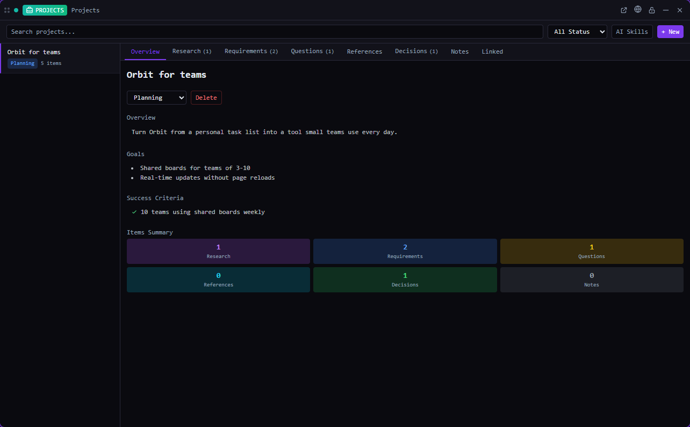

# Projects

Discovery for the big picture: goals, success criteria, research and open questions, before you plan.

*Bundled with QuadFlow.* (Plugin id `discovery`; shown as **Projects** in the app.)

A discovery project collects what you know — and what you still need to find out — about a larger
effort: an overview, goals, success criteria, and items for research, requirements, questions,
references, decisions and notes. Ideas and plans link to it, so you can see everything that
belongs to one effort in one place. When you know what to build, move on to a
[Plan](../plans/README.md).



## Features

- Discovery projects with **overview, goals and success criteria** and a status: *Discovery,
  Planning, In Progress, Completed, Archived*.
- One tab per item kind — **Research, Requirements, Questions, References, Decisions, Notes** —
  each item with a title, content, free-text status and optional metadata (e.g. a URL).
- **Linked** tab: the ideas and plans attached to the project, with plan step progress; link
  existing ideas from there.
- **AI skills**: `/kickoff-project` (guided setup of goals, research areas, requirements and
  questions), `/project-summary`, `/organize-projects`, run in a new agent session (Claude Code
  preferred).

## Usage

Open **Projects** from the Tools menu (or pin it to the toolbar), in a pane or a flyout. It needs
an open project folder.

| Command | Where | What it does |
|---|---|---|
| New Discovery Project | Palette (with a project) | Prompts for a title, creates the project and opens it |

The palette also searches discovery projects by title and overview (palette provider *Discovery*).

## CLI

`quadflow docs discovery` prints the agent doc ([docs/agent.md](docs/agent.md)).

| Command | Purpose |
|---|---|
| `quadflow discovery list [--status <s>] [--text <q>]` | List, newest first |
| `quadflow discovery get <id>` | One project with all items |
| `quadflow discovery create "<title>" [--overview …] [--goal …]… [--criterion …]…` | Create |
| `quadflow discovery update <id> [--title …] [--goal …]… [--no-goals] [--status <s>]` | Edit (`--goal` / `--criterion` replace the list) |
| `quadflow discovery item-add <id> --kind question --title "…" [--metadata '{"url":"…"}']` | Add an item |
| `quadflow discovery item-update` · `item-delete` · `items-reorder` | Edit items |
| `quadflow discovery linked <id>` | Linked ideas and plans |
| `quadflow ideas update <idea-id> --discovery <id>` | Link an idea (`--no-discovery` unlinks) |

Deleting a discovery project also clears the link on its ideas and plans.

## Permissions

| Permission | Why |
|---|---|
| `data:discovery:write` | Read and edit discovery projects |
| `data:ideas:write` | Link and unlink ideas |
| `data:plans:read` | Show linked plans and their progress |
| `agents:read` | Pick a provider for skill buttons |
| `agents:launch` | Run the discovery skills |

## Data

One JSON file per discovery project in `.quadflow/discovery/<id>.json` in the project, shared
through git. Links are stored on the other side, as `discoveryId` on ideas and plans.

## Development

```bash
cd plugins/discovery
npm run build        # quadflow-plugin build → dist/
```

```
src/index.tsx         definePlugin: tile `projects`, command, palette provider
src/model.ts          live collection over ctx.data.discovery, idea linking
src/ProjectsTile.tsx  project list, tabs per item kind, linked view, skills
```

Built on the public host API only. Authoring docs: [docs/plugins/](../../docs/plugins/README.md).

## License

AGPL-3.0-only, part of QuadFlow.
