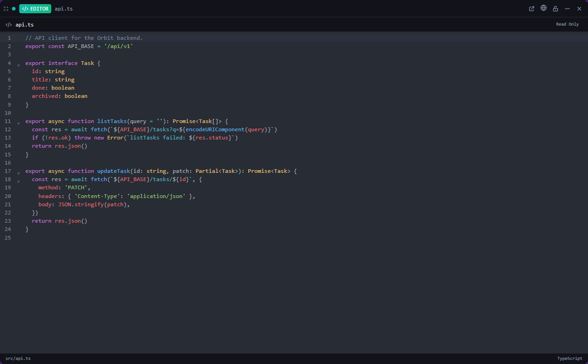

# Editor

**A CodeMirror file editor pane, one tile per file.**

*Bundled with QuadFlow.*

Open a file of the current project next to your terminals, edit it and save it. The editor opens
from file links in terminals, from the file explorer's *Open in Editor*, or from the palette.



## Features

- One tile per file: opening a file that is already open focuses its tile.
- Syntax highlighting, loaded on demand per language: JavaScript/TypeScript (incl. JSX/TSX),
  Python, Rust, CSS/SCSS/Less, HTML (also used for Vue and Svelte files), JSON/JSONL, Markdown, XML
  (also used for YAML and TOML), SQL, C/C++, Java/Kotlin and PHP. Other files open as plain text.
- Unsaved-changes indicator; save with `Mod-s` (Ctrl+S, or Cmd+S on macOS).
- Follows the QuadFlow theme.

## Usage

| Command | What it does |
|---|---|
| Open File in Editor… | Asks for a path and opens it (needs an open project) |

Other parts of QuadFlow run the same command, `editor/open`, with `{ "path": "<file>" }`. The path
can be absolute or relative to the project root.

The editor is a pane-only tile and needs an open project.

## Permissions

| Permission | Why |
|---|---|
| `fs:read:project` | Read the file being edited |
| `fs:write:project` | Save it |

## Data

None of its own: files are read from and written to the project directly.

## Development

```bash
cd plugins/editor
npm run build      # quadflow-plugin build --no-sidecar → dist/
npm run dev        # rebuild on change
npm test           # path helper tests (test/paths.test.ts)
```

- `src/index.tsx` — plugin entry: the `file` tile and the `open` command
- `src/EditorTile.tsx` — tile chrome, load/save, dirty state
- `src/CodeMirrorEditor.tsx` — the CodeMirror view and key bindings
- `src/languages.ts` — file extension → language loader
- `src/paths.ts`, `src/model.ts` — path normalization, opening and focusing tiles

The GUI e2e test is `scripts/ui/editor.test.mjs`. Plugin authoring docs:
[docs/plugins/](../../docs/plugins/README.md).

## License

AGPL-3.0-only, part of QuadFlow.
