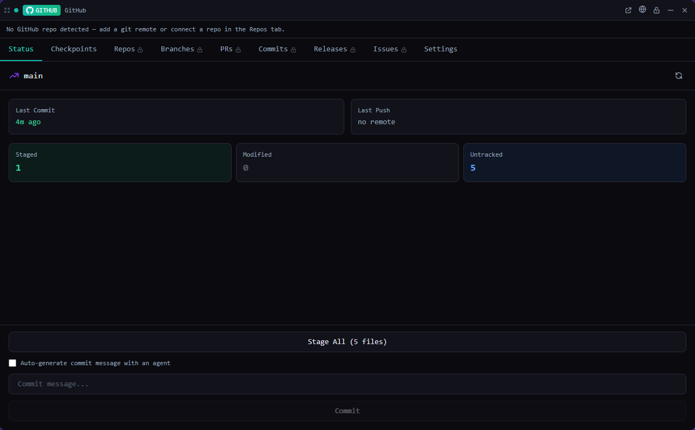

# GitHub

**Local git and GitHub for the current project, in one tile.**

*Bundled with QuadFlow.*

Status, commit and push without leaving your agents, take git checkpoints you can roll back to,
and browse the project's GitHub repositories, branches, pull requests, commits and releases. Issues
can be pushed to and imported from GitHub.



## Features

- **Status**: changed files, stage all, commit (with an AI-generated commit message from your agent
  provider) and push.
- **Checkpoints**: named snapshots of the working tree as annotated git tags (`qf-cp/<name>`), with a
  diff summary. Restoring runs `git reset --hard` to the tag and can create a safety checkpoint first.
- **Repositories**: connect GitHub repositories (or let the plugin detect the `origin` remote), pick a
  default one.
- **Branches, pull requests, commits, releases** of the connected repository.
- **Issue sync**: push a QuadFlow issue to GitHub (or sync a linked one), sync its comments, import
  GitHub issues as QuadFlow issues.
- **Repository setup**: `git init`, add a remote, discover sub-repositories, generate or edit
  `.gitignore` from the detected project types.
- **Toolbar mini widget**: branch, dirty state and last commit at a glance.

## Usage

Open the **GitHub** tool from the toolbar, as a pane or a flyout. The tile has tabs for Status,
Checkpoints, Repos, Branches, PRs, Commits, Releases, Issues and Settings.

Palette commands (available when a project is open):

| Command | Category |
|---|---|
| Create Git Checkpoint | Git |
| Commit All Changes | Git |
| Push | Git |
| Refresh Git Status | Git |
| Show Checkpoints | Git |
| Show Pull Requests | GitHub |
| Sync Issues with GitHub | GitHub |

The palette also searches checkpoints and connected repositories (provider *GitHub*).

### Signing in

GitHub calls go straight to the REST API (`api.github.com`) with a personal access token. In the
tile's **Settings** tab either paste a token (scopes `repo` and `read:org`; the setup screen links to
GitHub's token page with those scopes preselected) or choose **Use GitHub CLI token**, which reads
`gh auth token` once. The `gh` CLI is not needed otherwise. Local git features work without a token.

## Permissions

| Permission | Why |
|---|---|
| `shell:exec:git` | Status, commit, push, tags (checkpoints), branches |
| `shell:exec:gh` | Read the token of a signed-in GitHub CLI, on request |
| `shell:open-external` | Open repositories, pull requests and releases in the browser |
| `network:api.github.com` | GitHub REST API |
| `secrets` | Keep the GitHub token in the OS keychain |
| `fs:read:project` | Read `.gitignore`, discover sub-repositories |
| `fs:write:project` | Write `.gitignore` |
| `data:issues:write` | Import GitHub issues and link pushed ones |
| `agents:launch` | Generate commit messages with your agent provider |

## Data

| What | Where |
|---|---|
| GitHub token | OS keychain (entry `plugin:github:token`) |
| Connected repositories | Plugin storage, global (key `repositories`) |
| Checkpoint metadata | Plugin storage, per project (`checkpoint:<id>`); the git tag is the checkpoint itself |

## Development

```bash
cd plugins/github
npm run build      # quadflow-plugin build --no-sidecar → dist/
npm run dev        # rebuild on change
```

- `src/index.tsx` — plugin entry: tile, mini widget, commands, palette provider
- `src/services.ts` — GitHub REST client and local git operations, bound to the plugin context
- `src/stores/` — Zustand stores for GitHub data, git status and checkpoints
- `src/views/` — one view per tab, plus token setup and the mini widget

The GUI e2e test is `scripts/ui/github.test.mjs`. Plugin authoring docs:
[docs/plugins/](../../docs/plugins/README.md).

## License

AGPL-3.0-only, part of QuadFlow.
