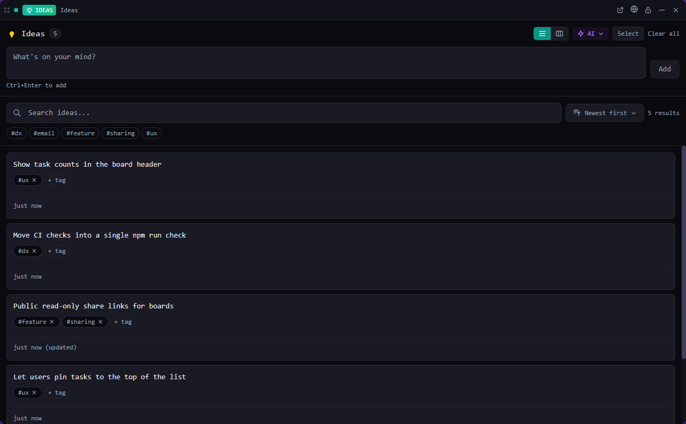

# Ideas

Capture thoughts the moment you have them, then tag, refine and promote them into real work.

*Bundled with QuadFlow.*

Ideas is the lightweight end of QuadFlow's project tools: a quick inbox for feature ideas,
improvements and notes that live in the project (and in git), shared by you and your agents.
When an idea is ready, promote it to an issue or hand it straight to an agent.



## Features

- **List and kanban views.** The board groups ideas into *Ideas*, *In Progress* and *Done*
  (by the `in-progress` and `implemented` tags).
- **Tags**, search and sorting (newest, oldest, most tags, recently updated, alphabetical).
- **Suggestions**: agents (or you) propose a reword, expansion, clarification or summary; accept
  to replace the text or reject it. The original text is kept and can be restored.
- **Notes** on each idea, **merge** several ideas into one, **archive** without deleting.
- **Promote to issue** and **send to agent** (the idea becomes the first prompt, left unsubmitted
  so you can edit it).
- **Link to a discovery project** from the [Projects](../discovery/README.md) tool.
- **AI skills** menu: runs a QuadFlow skill in a new agent session (Claude Code preferred) —
  `/organize-ideas`, `/suggest-improvements`, `/check-implemented`, `/idea-summary`,
  `/ideas-maintenance`.

## Usage

Open **Ideas** from the Tools menu (or pin it to the toolbar), in a pane or a flyout. It needs an
open project.

| Command | Where | What it does |
|---|---|---|
| New Idea | Palette (with a project) | Prompts for the text and saves it |
| Open Ideas | Used by toasts and links | Opens the Ideas tile |

The palette also searches the project's ideas by text and tag (palette provider *Ideas*).

## CLI

Agents use the same data through the `quadflow` CLI; `quadflow docs ideas` prints the full agent
doc ([docs/agent.md](docs/agent.md)).

| Command | Purpose |
|---|---|
| `quadflow ideas list [--text Q] [--tag T]…` | List (alias `search`), newest first |
| `quadflow ideas create "<text>" [--tag T]…` | Capture an idea |
| `quadflow ideas update <id> [--content …] [--tags a,b] [--archived true\|false]` | Edit |
| `quadflow ideas add-tag\|remove-tag <id> <tag>` · `bulk-tag <ids> <tag>` | Tagging |
| `quadflow ideas add-suggestion <id> --kind reword "<text>"` | Propose a rewrite |
| `quadflow ideas merge <id,id,…> <keep-id>` | Merge into one idea |
| `quadflow ideas add-note <id> "<text>"` · `archive <id>` · `revert <id>` | Notes, archive, restore |
| `quadflow ideas stats` · `export --format json\|markdown\|csv` | Overview and export |

Every command takes `--json`. Changes made from the CLI appear live in the tile.

## Permissions

| Permission | Why |
|---|---|
| `data:ideas:write` | Read and edit the project's ideas |
| `data:issues:write` | Promote an idea to an issue |
| `data:discovery:read` | List discovery projects to link an idea to |
| `agents:read` | List agent providers for *send to agent* |
| `agents:launch` | Start an agent with an idea or a skill |

## Data

One JSON file per idea in `.quadflow/ideas/<id>.json` in the project, so ideas are shared through git.

## Development

```bash
cd plugins/ideas
npm run build        # quadflow-plugin build → dist/
```

```
src/index.tsx        definePlugin: tile, commands, palette provider
src/model.ts         live collection over ctx.data.ideas (plugin-kit) + mutations
src/IdeasTile.tsx    list / kanban UI, skills menu, promote, send to agent
src/DiscoveryLink.tsx discovery project picker
```

Ideas is a good first example of a data-backed tool: everything goes through the public host API
(`ctx.data.ideas.*`, `ctx.data.issues.create`, `ctx.agents.*`) and nothing is imported from the
shell. See [docs/plugins/migrating-a-tool.md](../../docs/plugins/migrating-a-tool.md) and
[docs/plugins/](../../docs/plugins/README.md).

## License

AGPL-3.0-only, part of QuadFlow.
