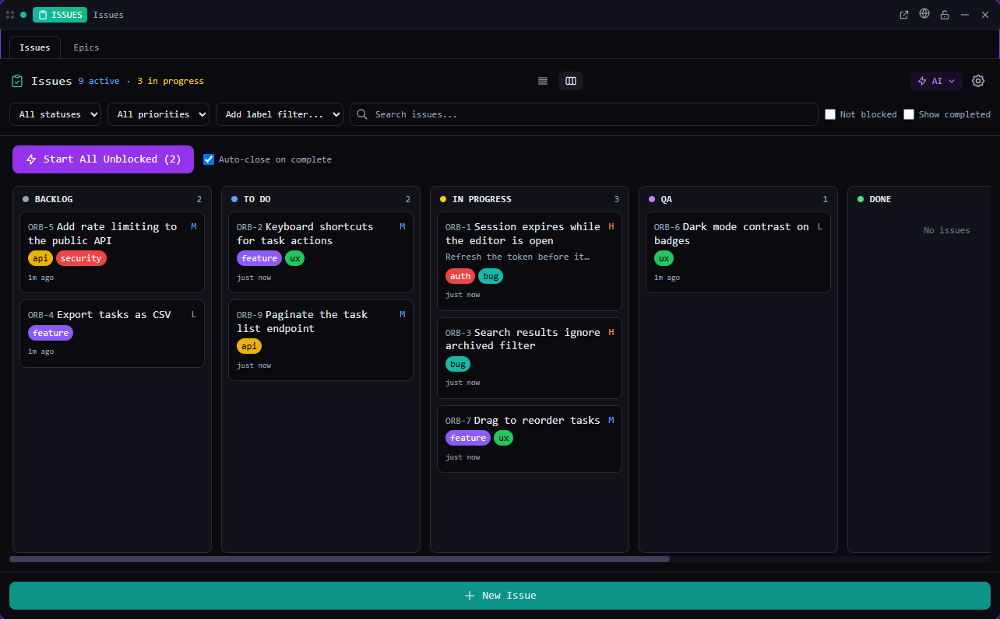

# Issues

Track bugs and tasks in the project, and hand them to agents to work on.

*Bundled with QuadFlow.*

Issues is QuadFlow's work tracker: a kanban board and list of issues with priorities, labels,
acceptance criteria, dependencies and epics, stored as plain files in the project. Agents read and
update the same issues through the `quadflow` CLI, and you can start an agent on any issue with
one click.



## Features

- **List and kanban views** with columns *Backlog, To Do, In Progress, QA, Blocked, Needs Human,
  Done*; drag cards between columns (with undo).
- **Filters** by status, priority and label; **bulk actions** (status, priority, delete) on a selection.
- **Issue detail**: markdown body, user story, checkable acceptance criteria, comments and history.
- **Dependencies**: *blocked by* (hard) and *depends on* (informational), with a dependency graph.
- **Epics** with their own list, detail and form views; **labels** with colours.
- **Project code**: issues are numbered `CODE-n` (e.g. `WEB-12`); set the prefix in the tile.
- **Work on with an agent**: *Work on this Issue* starts an agent with `/issue-to-prompt CODE-n`
  (choose the provider, optionally auto-close the terminal when the issue is done). *Start all
  unblocked* launches one agent per startable `todo` issue. Drag a card onto a terminal to hand
  it over. Interrupted sessions can be resumed from the issue.
- **AI skills**: `/issue-summary`, `/organize-issues`, `/triage-issues`, `/check-issue-progress`
  in a new agent session (Claude Code preferred).

## Usage

Open **Issues** from the Tools menu (or pin it to the toolbar), in a pane or a flyout. It needs
an open project.

| Command | Where | What it does |
|---|---|---|
| New Issue | Palette (with a project) | Prompts for a title, creates the issue and shows a toast |
| Open Issue by Ref | Palette (with a project) | Prompts for `CODE-n`, `n` or an id and opens it |
| Open Issues | Used by toasts and links | Opens the Issues tile |

The palette also searches issues by ref and title (palette provider *Issues*).

## CLI

`quadflow docs issues` prints the agent doc ([docs/agent.md](docs/agent.md)). Issues are referenced
as `CODE-n`, `#n`, `n` or by id.

| Command | Purpose |
|---|---|
| `quadflow issues list [--status todo,in_progress] [--label bug]` | Open issues, by priority |
| `quadflow issues get WEB-12` | One issue with comments and history |
| `quadflow issues create "<title>" --priority high --criterion "<testable>"` | Create |
| `quadflow issues update WEB-12 --body "…" --blocked-by WEB-3` | Edit fields |
| `quadflow issues status WEB-12 qa` | Move to QA for human review |
| `quadflow issues claim WEB-12 --agent-label "<me>"` → `heartbeat` → `release` | Agent claims |
| `quadflow issues comment WEB-12 --body "…"` · `criterion WEB-12 <id> --checked true` | Progress |
| `quadflow issues close WEB-12` · `reopen` · `children` · `blocking` | Lifecycle and relations |
| `quadflow labels list\|upsert\|delete` · `quadflow epics list\|get\|create\|update\|delete` | Labels and epics |

Agents should move finished work to `qa`; a human closes it. Every command takes `--json`.

## Permissions

| Permission | Why |
|---|---|
| `data:issues:write` | Read and edit issues, epics and labels |
| `project:config:write` | Change the project code in `.quadflow/config.json` |
| `agents:read` | List providers for *Work on this Issue* |
| `agents:launch` | Start agents on issues and skills |
| `clipboard:write` | Copy issue refs |

## Data

In the project's `.quadflow/` folder, shared through git: `issues/<id>.json`, `epics/<id>.json`,
`labels.json` and the project code in `config.json`. The next issue number is machine state in
`.quadflow/local/state.json`.

## Development

```bash
cd plugins/issues
npm run build        # quadflow-plugin build → dist/
```

```
src/index.tsx        definePlugin: tile, commands, palette provider
src/model.ts         live collections (issues, epics, labels), mutations, workOn / resume
src/IssuesTile.tsx   shell of the tile; KanbanBoard, IssueListView, IssueDetailView, Epic*View
src/convert.ts       wire format ↔ UI types; DependencyGraph.tsx the graph view
```

Built only on the public host API (`ctx.data.issues.*`, `ctx.data.projectConfig`, `ctx.agents.*`).
Authoring docs: [docs/plugins/](../../docs/plugins/README.md).

## License

AGPL-3.0-only, part of QuadFlow.
