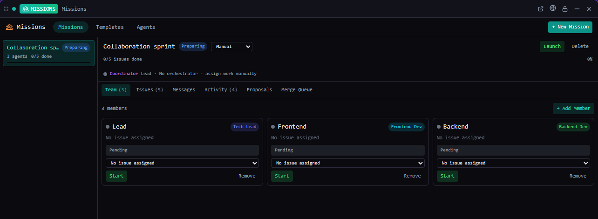

# Missions

Run a team of agents on a shared set of issues — each in its own git worktree, coordinated through QuadFlow.

*Bundled with QuadFlow.*

A mission is a team of agent sessions (members) working issues from the [Issues](../issues/README.md)
tool. Each member has a role, an assigned issue, its own branch and worktree, and a heartbeat.
An optional coordinator proposes the team and assignments for you to approve; finished work goes
through a merge queue. Agents coordinate with each other only through the `quadflow` CLI.



## Features

- **Mission control**: missions with status (*Preparing, Active, Paused, Completed, Cancelled*)
  and an orchestration mode — *Manual* (you assign), *On-Demand* (a coordinator assigns, then
  stops) or *Persistent* (a coordinator keeps monitoring and reassigning).
- **Team**: agent cards with role, status, assigned issue and time since the last heartbeat; a
  live terminal preview of each member; focus, nudge or stop a member, or stop all.
- **Isolation**: each member gets a git worktree on branch `agent/<mission>/<name>` (falls back to
  the project directory outside git). The provider's `prepareWorktree` hook writes the member's
  context and file scope (enforced for Claude Code, advisory for Codex).
- **Proposals**: a coordinator proposes agents, roles, issues and allowed files; you approve or
  reject them in the tile.
- **Messages and activity**: blockers, questions, findings, completions and decisions logged by
  the agents.
- **Merge queue**: closing an issue queues the member's branch for merging.
- **Templates** (built-in and your own) and **agent definitions** (roles such as Scrum Master,
  Tech Lead, Frontend, Backend, QA, Security, Docs, … with provider and model).

## Usage

Open **Missions** from the Tools menu (or pin it to the toolbar), in a pane or a flyout. It needs
an open project. The tile has three tabs: *Missions*, *Templates* and *Agents*; a mission's detail
view has *Team, Issues, Messages, Activity, Proposals* and *Merge Queue*.

| Command | Where | What it does |
|---|---|---|
| New Mission | Palette (with a project) | Opens the tile with the New Mission dialog |
| New Mission from Template | Palette (with a project) | With `{ templateId, name? }` creates the mission; otherwise opens the Templates tab |
| Open Missions | Used by toasts and links | Opens the Missions tile |

The palette lists the project's missions and a "New mission from template …" entry per template.

## CLI

What agents run; `quadflow docs missions` prints the full doc ([docs/agent.md](docs/agent.md)).
Members are referenced by id or unique name, issues by id, `CODE-n` or `n`.

| Command | Purpose |
|---|---|
| `quadflow missions list` · `get` · `create "<name>" [--template …] [--mode …] [--issues 3,4]` · `update` · `delete` | Missions |
| `quadflow missions progress <m>` · `issues <m>` · `assign <m> <ref>…` | Work items |
| `quadflow missions claim-next <m> <me>` | Take the next unblocked, unclaimed `todo` issue |
| `quadflow missions heartbeat <m> <me>` | Every ~2 minutes |
| `quadflow missions inbox <m> <me>` · `send <m> "<text>" --from <me> [--to …] [--kind …]` · `log` | Communication |
| `quadflow missions propose <m> --goal "…" --agents '[…]'` · `proposals <m>` | Coordinator proposals |
| `quadflow missions merge-queue <m>` · `merge-next` · `merge-update <m> <entry> --status merged` | Merge queue |
| `quadflow missions templates` · `template-upsert` · `agents` · `agent-upsert` | Templates and agent definitions |

## Permissions

| Permission | Why |
|---|---|
| `data:missions:write` | Read and edit missions, members, messages, proposals and templates |
| `data:issues:write` | Pick and assign issues |
| `agents:read` | List providers and models for members |
| `agents:launch` | Start member and coordinator sessions, prepare their worktrees |
| `terminal:io` | Preview, nudge and stop member terminals |
| `shell:exec:git` | Create worktrees and merge branches |

## Data

- Missions (members, messages, activity, proposals, merge queue):
  `.quadflow/local/missions/<id>/` — machine-local, not committed.
- Custom templates: `.quadflow/mission-templates/<id>.json` — shared through git.
- Custom agent definitions: the app database. Built-in templates and definitions (`builtin-*`)
  ship with QuadFlow.
- Worktrees: `.worktrees/mission-<id>/<member>/` in the project.

## Development

```bash
cd plugins/missions
npm run build        # quadflow-plugin build → dist/
npm test             # node --test: agent prompts and context overlays
```

```
src/index.tsx          definePlugin: tile, commands, palette provider
src/model.ts           missions state, worktrees (git), launches, nudges
src/prompts.ts         member / coordinator prompts and worktree context overlays
src/MissionsTile.tsx   tabs; MissionDetail.tsx, AgentCard.tsx, Library.tsx, dialogs.tsx
src/TerminalPreview.tsx read-only live preview of a member's terminal
```

To make your own agent provider work with Missions, implement its `prepareWorktree` hook — see
[docs/plugins/agent-providers.md](../../docs/plugins/agent-providers.md). Authoring docs:
[docs/plugins/](../../docs/plugins/README.md).

## License

AGPL-3.0-only, part of QuadFlow.
