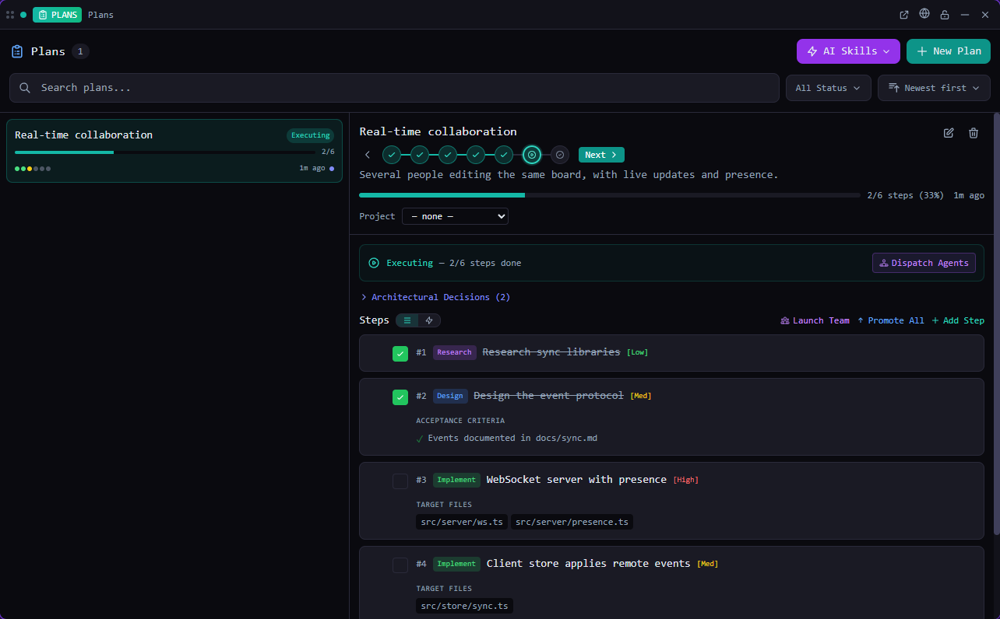

# Plans

Turn a spec into ordered steps, promote the steps to issues and watch agents work them.

*Bundled with QuadFlow.*

Plans is where larger pieces of work are designed before they are built. A plan moves through a
pipeline — draft the spec, review it, decompose it into steps, review the steps, promote them to
issues, execute — and keeps the plan and its issues in sync while agents work.



## Features

- **Phase stepper**: *Spec Draft → Review Spec → Decompose → Review Steps → Promote → Execute →
  Complete*, with the next action for each phase.
- **Spec editor** with *Generate with AI* (`/new-spec`) and focused agent reviews (`/review-spec`)
  whose findings land as plan comments.
- **Decomposition**: break the spec into epic steps (`/decompose-spec`), expand an epic into
  detailed steps (`/expand-epic`) and verify coverage (`/verify-plan`).
- **Steps** with kind, effort, acceptance criteria, target files, parent step and dependencies;
  hierarchical list view and a dependency graph.
- **Architectural decisions, risks and context** sections on every plan.
- **Promotion profile**: labels (auto from step kind, none or custom), epics for parent steps,
  blockers from step dependencies. Promotion is idempotent.
- **Multi-agent coordination view** of the promoted issues and the agents on them, plus a
  *dispatch* action (`/dispatch`) that proposes a mission.
- **New Plan wizard** (title, project type, starting point); link a plan to an idea or a
  [discovery project](../discovery/README.md).
- **AI skills**: `/organize-plans`, `/plan-summary`, `/plan-from-idea`, `/update-plan-progress`,
  `/create-rich-plan`. Skills run in a new agent session (Claude Code preferred).

## Usage

Open **Plans** from the Tools menu (or pin it to the toolbar), in a pane or a flyout. It needs an
open project.

| Command | Where | What it does |
|---|---|---|
| New Plan | Palette (with a project) | Opens the tile with the New Plan wizard |
| Open Plans | Used by toasts and links | Opens the Plans tile |

The palette also searches plans by title and shows their status and step progress.

## CLI

`quadflow docs plans` prints the agent doc ([docs/agent.md](docs/agent.md)).

| Command | Purpose |
|---|---|
| `quadflow plans list [--status executing] [--idea <id>] [--search text]` | List, newest first |
| `quadflow plans get <plan_id>` | Full plan with steps and comments |
| `quadflow plans create "<title>" [--spec-content …] [--decision "…"]` | Create |
| `quadflow plans update <plan_id> --status review_steps` | Move through the pipeline |
| `quadflow plans step-add <plan_id> "<title>" [--parent …] [--depends-on …] [--criterion …]` | Add a step |
| `quadflow plans step-update <step_id> --status completed` · `step-delete` · `steps-reorder` | Edit steps |
| `quadflow plans comment <plan_id> --body "…" --kind review` · `comments` · `comment-delete` | Comments |
| `quadflow plans promote <plan_id> [--step <step_id>]` | Promote steps to issues |

**Status sync:** moving a promoted issue moves its step (`done` → `completed`, `in_progress`/`qa`
→ `in_progress`, else `pending`) and vice versa. A plan becomes `executing` when a step starts and
`completed` when every non-skipped step is done.

## Permissions

| Permission | Why |
|---|---|
| `data:plans:write` | Read and edit plans, steps and comments |
| `data:issues:write` | Promote steps to issues and show their status |
| `data:ideas:read` | Link a plan to an idea |
| `data:discovery:read` | Link a plan to a discovery project |
| `agents:read` | Pick a provider for skill buttons |
| `agents:launch` | Run the spec, decomposition and planning skills |

## Data

One JSON file per plan (with its steps and comments) in `.quadflow/plans/<id>.json` in the
project, shared through git. Promoted issues live in `.quadflow/issues/` and record their source
plan and step.

## Development

```bash
cd plugins/plans
npm run build        # quadflow-plugin build → dist/
```

```
src/index.tsx               definePlugin: tile, commands, palette provider
src/model.ts                live collection over ctx.data.plans + promotion helpers
src/PlansTile.tsx           list / detail, steps, coordination dashboard
src/PlanPhaseStepper.tsx    pipeline; SpecEditorView, DecompositionView, PlanCommentsPanel
src/PromotionProfileEditor.tsx, DependencyGraph.tsx, DiscoveryLink.tsx
```

Built on the public host API only. Authoring docs: [docs/plugins/](../../docs/plugins/README.md).

## License

AGPL-3.0-only, part of QuadFlow.
