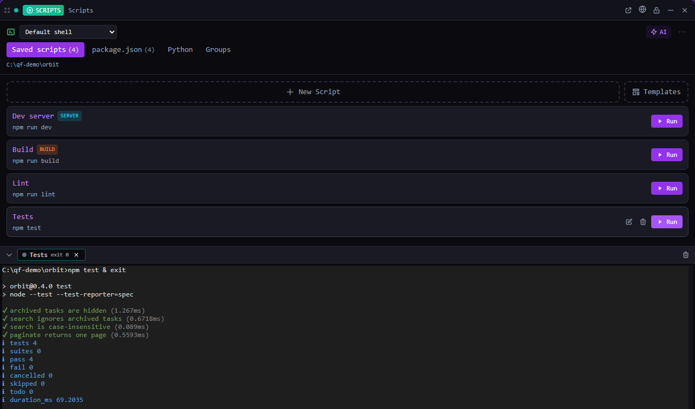

# Scripts

Run your project's builds, tests and dev servers with one click — and let an agent fix a failed build.

*Bundled with QuadFlow.*

Scripts collects everything runnable in a project: `package.json` scripts and Python entry points
it detects, plus saved scripts with their own environment variables, setup commands, working
directory and shell. Runs stream live output, groups start a whole dev stack at once, and
saved scripts live in the project so your team and your agents share them.



## Features

- **Tabs**: *Saved scripts*, *package.json* (detected), *Python* (detected), *Groups*.
- **Saved scripts** with command, setup commands, env vars, working directory, shell, platform
  restrictions, kind (`command`, `server`, `build`), tags and pinning; start from a template
  (e.g. Tauri dev/build with CUDA or Metal, clean build, Docker build).
- **Live output panel**: one tab per run with an interactive terminal view; stop one run or all.
  The panel keeps the last 10 runs (finished ones are dropped first); runs keep going when you
  close the tile.
- **Script groups**: run several scripts in parallel (a dev stack) or in sequence (a pipeline),
  with per-member delays.
- **Terminal environments** per machine (shells, Visual Studio developer prompts, custom init
  commands). A script names its environment, each machine resolves the name; a default applies
  to scripts that name none.
- **Auto-fix failed builds**: when a run fails, an agent is launched in unattended mode with the
  error, QuadFlow waits for it and re-runs the script (up to 5 attempts).
- **Server scripts** can open their preview URL when they start.
- **AI skills**: `/setup-scripts`, `/detect-environments`, `/setup-environment`,
  `/assign-environment`, `/script-summary`.

## Usage

Open **Scripts** from the Tools menu (or pin it to the toolbar), in a pane or a compact flyout.
It needs an open project.

| Command | Where | What it does |
|---|---|---|
| New Script | Palette (with a project) | Opens the tile with the new-script editor |
| Stop All Running Scripts | Palette | Stops every run started by the plugin |
| Run Script | Other plugins, `{ scriptId }` or `{ groupId }` | Runs a saved script or group and reveals the output |
| Open Scripts | Used by toasts and links | Opens the Scripts tile |

The palette provider *Scripts* offers "run <script / group>" directly from the palette.

## CLI

`quadflow docs scripts` prints the agent doc ([docs/agent.md](docs/agent.md)).

| Command | Purpose |
|---|---|
| `quadflow scripts list [--text Q] [--tag T] [--pinned] [--platform P]` | List (also `search`) |
| `quadflow scripts create "<name>" --command "<cmd>" [--setup …]… [--env K=V]… [--environment "<name>"] [--kind server]` | Save a script |
| `quadflow scripts update <id> [same flags] [--clear <field>]…` · `delete` | Edit |
| `quadflow scripts get-command <id> [--platform P]` | Resolve the full command line for this machine |
| `quadflow scripts tag\|untag` · `pin\|unpin` · `archive\|unarchive` | Organise |
| `quadflow scripts groups list\|get\|create\|update\|delete\|add\|remove` | Script groups |
| `quadflow scripts env-list` · `env-get` · `env-add` · `env-delete` · `env-detect` | Terminal environments |

`env-detect` finds cmd, Windows PowerShell, pwsh, Git Bash and Visual Studio (via vswhere) on
Windows, and zsh, bash, sh and pwsh on macOS and Linux.

## Permissions

| Permission | Why |
|---|---|
| `data:scripts:write` | Read and edit scripts, groups and environments |
| `terminal:spawn` | Run scripts in terminals the plugin owns |
| `fs:read:project` | Detect `package.json` and Python scripts |
| `agents:read` | Find a provider for auto-fix and skills |
| `agents:launch` | Start the auto-fix agent and skill sessions |

## Data

- Saved scripts: `.quadflow/scripts/<id>.json`; groups: `.quadflow/script-groups/<id>.json` —
  in the project, shared through git.
- Terminal environments are machine-specific (paths to shells and toolchains) and live in the
  app database.

## Development

```bash
cd plugins/scripts
npm run build        # quadflow-plugin build → dist/
npm test             # node --test: run logic (failure detection, exit handling)
```

```
src/index.tsx        definePlugin: tile, commands, palette provider
src/model.ts         shared state: collections, detected scripts, runs (PTYs), auto-fix
src/detect.ts        package.json / Python detection; runLogic.ts pure run helpers
src/ScriptsTile.tsx  tabs and lists; RunPanel.tsx output; *EditModal.tsx editors
src/constants.ts     templates, skills, limits
```

Runs belong to the plugin model, not to a tile, so the pane and flyout share them and closing a
tile never kills a run. Authoring docs: [docs/plugins/](../../docs/plugins/README.md).

## License

AGPL-3.0-only, part of QuadFlow.
