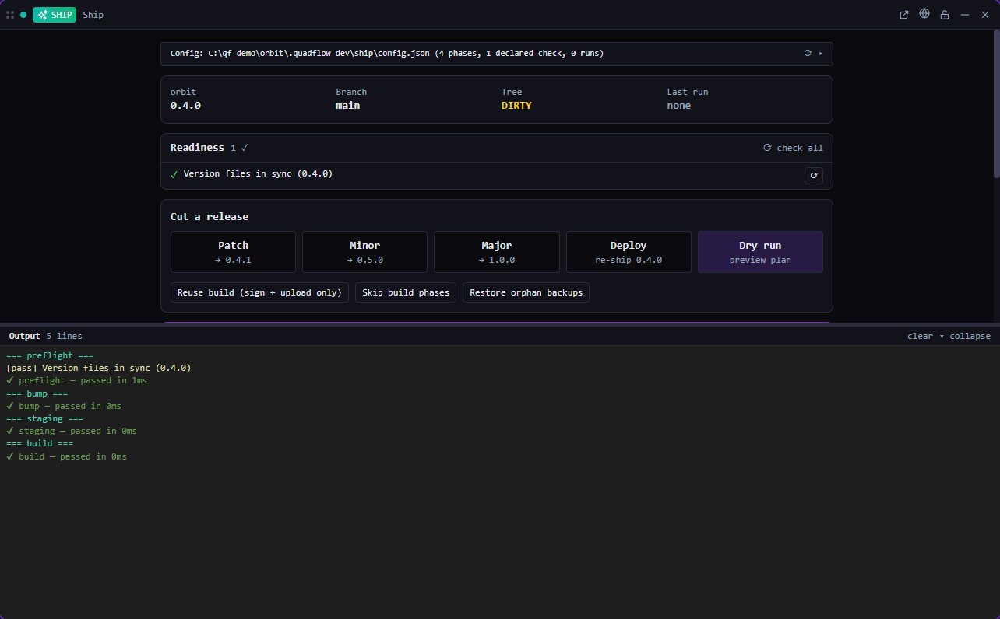

# Ship

Cut releases from inside QuadFlow: version status, readiness checks, a typed release pipeline and run history.

*Bundled with QuadFlow.*

Ship is the UI for QuadFlow's generic release pipeline. A project describes its release once in
`.quadflow/ship/config.json` — the files that carry the version and an ordered list of typed
phases (checks, bump, build, sign, stage, publish or deploy, git commit/tag/push, shell steps) —
and Ship runs it the same way for desktop apps, web deploys, libraries, containers and static
sites. QuadFlow ships its own releases with it.



## Features

- **Status**: the version in every version file (and whether they agree), branch, dirty tree,
  last run.
- **Readiness checks** (clean tree, branch, tools on `PATH`, `gh` auth, disk space, signing
  identities, deploy CLI logins, …): re-run one check, or run its fix command.
- **Cut a release**: patch, minor or major bump, or a **deploy** of the current version without a
  bump; variants that reuse or skip the build. A confirmation shows mode, flags and branch first.
- **Dry run**: resolve the phase plan with every token substituted; nothing is executed or recorded.
- **Live output** while a run is in progress, **abort**, and restore of crash backups.
- **Run history**: every run keeps its own record and saved output; open a published release in
  the browser.
- **Set up with a template** (minimal, library publish, GitHub release binaries, Vercel, Railway,
  Fly, Netlify, Cloudflare Pages, Docker, S3 static site, Tauri for Windows or macOS) or
  **configure with an agent**: the `setup-ship` skill detects your tooling and writes the config.
- Build phases marked `externalTerminal` run in a terminal tile you can watch.

## Usage

Open **Ship** from the Tools menu (or pin it to the toolbar), in a pane or a flyout. It needs an
open project; without a config the tile offers the template picker and the agent setup.

| Command | Where | What it does |
|---|---|---|
| Dry-run the release pipeline | Palette (with a project) | Previews the phase plan of the current config |
| Configure the release pipeline with an agent | Palette (with a project) | Starts an agent with the `setup-ship` skill |
| Open Ship | Used by toasts and links | Opens the Ship tile |

The palette provider *Ship runs* finds runs by version, status or mode.

## CLI

`quadflow docs ship` prints the agent doc ([docs/agent.md](docs/agent.md)), including every phase
type, readiness check and template.

| Command | Purpose |
|---|---|
| `quadflow ship detect` · `templates [--id <t> --param k=v]` | Inspect tooling; preview templates |
| `quadflow ship init [--template <t>] [--param k=v]… [--force]` | Write a config |
| `quadflow ship config show\|validate\|save --file <f>\|delete` | Manage the config |
| `quadflow ship status` · `readiness [--check <id>]` · `fix <check-id>` | Before releasing |
| `quadflow ship bump patch\|minor\|major [--dry-run]` | Bump version files only |
| `quadflow ship run patch\|minor\|major\|deploy [--dry-run] [--skip-build] [--reuse-build] [--draft] [--config <f>]` | Run the pipeline |
| `quadflow ship list` (alias `runs`) · `get <run-id\|version>` · `abort [<run-id>]` | Runs |
| `quadflow ship restore-backups` · `diagnostics` | Recovery and troubleshooting |

## Permissions

| Permission | Why |
|---|---|
| `data:ship:write` | Read and write the ship config, start and abort runs |
| `terminal:spawn` | Run `externalTerminal` phases in a visible terminal |
| `agents:read` | Find a provider for the setup agent |
| `agents:launch` | Start the `setup-ship` agent |
| `clipboard:write` | Copy a readiness check's suggested command |
| `shell:open-external` | Open a published release in the browser |

## Data

- Config: `.quadflow/ship/config.json` in the project (shared through git), or any config file
  passed with `--config`.
- Runs: `.quadflow/local/ship/runs/<run-id>.json` — machine-local, not committed, rewritten after
  every phase so a crash still leaves a trail.

## Development

```bash
cd plugins/ship
npm run build        # quadflow-plugin build → dist/
```

```
src/index.tsx       definePlugin: tile, commands, palette provider
src/model.ts        state over ctx.data.ship (status, readiness, runs, external terminal phases)
src/ShipTile.tsx    status, readiness, release controls, history, template picker
src/OutputPane.tsx  live and saved run output
```

The pipeline itself (phases, checks, templates) lives in `quadflow-core`; the plugin only drives
it through the host API. Authoring docs: [docs/plugins/](../../docs/plugins/README.md); how
QuadFlow releases itself: [docs/RELEASING.md](../../docs/RELEASING.md).

## License

AGPL-3.0-only, part of QuadFlow.
