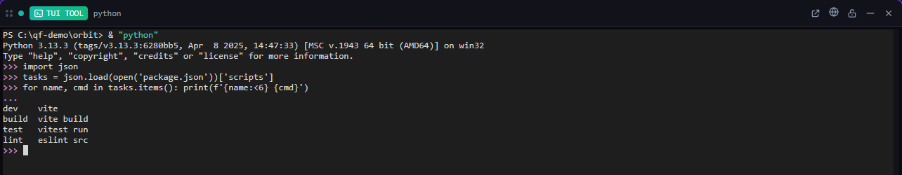

# TUI Tool

**Run any terminal program in a tile: lazygit, htop, a REPL.**

*Bundled with QuadFlow.*

Give your favourite terminal UI its own toolbar button. Each TUI tool runs one program in a pane or
a flyout; in a flyout the program keeps running while the flyout is closed, so reopening it is
instant.



## Features

- One tool config per program, each with its own executable, arguments, working directory and init
  commands.
- Pane or flyout; several TUI tools side by side.
- The program keeps running when its flyout is hidden or its pane is remounted, and is stopped when
  the tile is closed for good.
- When the program exits, the shell stays and a **Restart** button starts it again.
- Ad-hoc tiles from the palette for a one-off command line.

## Usage

Add a **TUI Tool** from the Tools menu, once per program, and fill in its settings:

| Setting | Description |
|---|---|
| Executable (required) | Command or path, e.g. `lazygit` |
| Arguments | One entry per argument; quoted when needed |
| Working directory | Absolute, or relative to the project; default the project root |
| Init commands | Typed into the shell before the program starts |

The program is started by typing one line into a fresh shell: PowerShell on Windows
(`& "<exe>" <args>`), the default POSIX shell elsewhere.

| Command | What it does |
|---|---|
| Run Program in Tile… | Asks for a command line (e.g. `node -i`) and opens a tile running it |

## Permissions

| Permission | Why |
|---|---|
| `terminal:spawn` | Start the program's terminal (PTY) and show it in the tile |

## Data

None of its own. The program settings are part of each tool config.

## Development

```bash
cd plugins/tui
npm run build      # quadflow-plugin build --no-sidecar → dist/
npm run dev        # rebuild on change
npm test           # command-line building tests (test/command.test.ts)
```

- `src/index.tsx` — plugin entry: the `run` tile and the `run-command` command
- `src/TuiTile.tsx` — spawns and attaches the PTY, exit and restart handling
- `src/command.ts` — program settings and the shell line that starts them (pure, unit-tested)
- `src/model.ts` — tile → terminal map; kills the PTY when a tile is closed

The GUI e2e test is `scripts/ui/tui.test.mjs`. Plugin authoring docs:
[docs/plugins/](../../docs/plugins/README.md).

## License

AGPL-3.0-only, part of QuadFlow.
