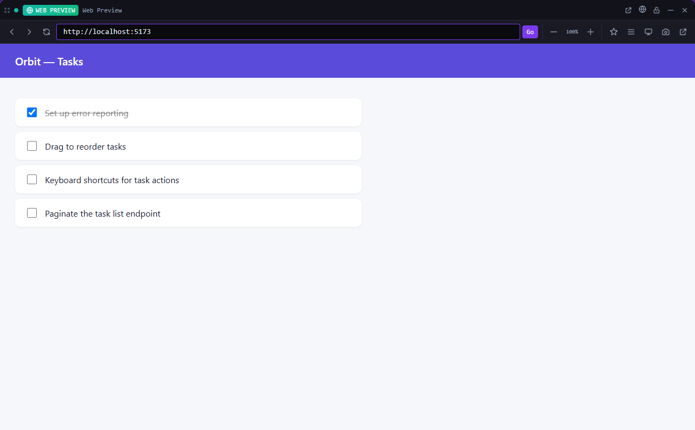

# Web Preview

**Preview a web page, typically your dev server, in a tile.**

*Bundled with QuadFlow.*

An embedded browser view next to your terminals, so you can watch a dev server while agents change
the code. Server scripts in the Scripts tool that have a preview URL open it here automatically.



## Features

- Address bar with back, forward and reload.
- Zoom from 30% to 200% in 10% steps, with reset.
- Mobile view (a 390 px wide viewport) and desktop view.
- Per-project bookmarks: add, rename, remove.
- Screenshot of the page to the clipboard.
- Open the current page in your default browser.
- Remembers the URL, zoom and view mode of each tile.

The page is a native child webview. QuadFlow hides it while a menu, dialog or flyout covers the
tile, and closes it with the tile.

## Usage

Open the **Web Preview** tool from the toolbar, as a pane or a flyout, and type a URL
(e.g. `http://localhost:3000`). There is one Web Preview tile at a time.

| Command | What it does |
|---|---|
| Open URL in Web Preview… | Asks for a URL; navigates the open preview or opens one |

Other plugins run the same command, `web-preview/open-url`, with `{ "url": "<url>" }`.

## Permissions

| Permission | Why |
|---|---|
| `native:webview` | Show the page in a child webview on the tile |
| `native:screen-capture` | Capture the tile for the screenshot |
| `clipboard:write` | Put the screenshot on the clipboard |
| `shell:open-external` | Open the page in your default browser |

## Data

Bookmarks live in the plugin's own storage, per project (key `bookmarks`). Per-tile URL, zoom and
view mode are saved with the tile.

## Development

```bash
cd plugins/web-preview
npm run build      # quadflow-plugin build --no-sidecar → dist/
npm run dev        # rebuild on change
```

- `src/index.tsx` — plugin entry: the `preview` tile and the `open-url` command
- `src/WebPreviewTile.tsx` — toolbar, navigation, zoom, mobile view, screenshot
- `src/webviews.ts` — child webview lifecycle per tile
- `src/bookmarks.ts` — per-project bookmark store

The GUI e2e test is `scripts/ui/web-preview.test.mjs`. Plugin authoring docs:
[docs/plugins/](../../docs/plugins/README.md).

## License

AGPL-3.0-only, part of QuadFlow.
